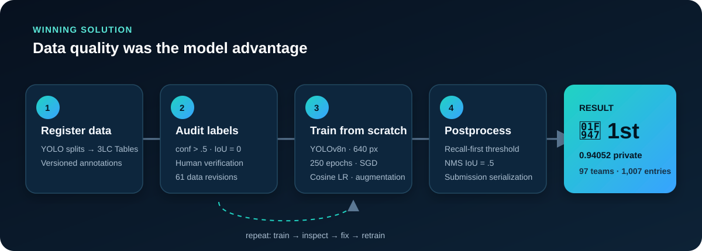
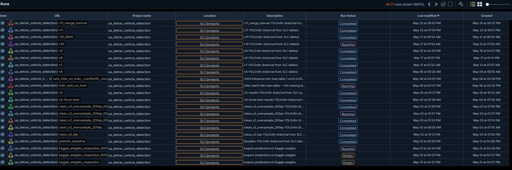
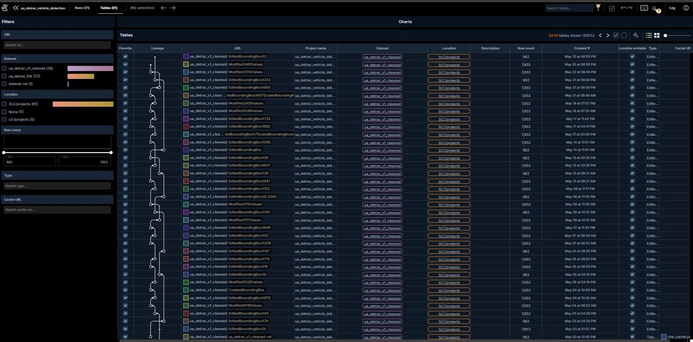

<div align="center">

# Data-Centric Multi-Vehicle Detection

### 🥇 1st Place — 3LC Multi-Vehicle Detection Challenge

**A human-in-the-loop label auditing pipeline that turned imperfect annotations into a winning YOLOv8n detector.**

[](https://www.python.org/)
[](https://pytorch.org/)
[](https://docs.ultralytics.com/)
[](https://3lc.ai/)
[](LICENSE)

[Competition](https://www.kaggle.com/competitions/3-lc-multi-vehicle-detection-challenge) · [Official winner announcement](https://www.linkedin.com/posts/kelly-walker-6762278_another-kaggle-competition-in-the-books-activity-7476315509974671360-9zff) · [Cleaned labels](https://www.kaggle.com/datasets/cdanht2/cleaned-data-v11) · [Model weights](https://www.kaggle.com/datasets/cdanht2/3lc-vehicle-detection-2nd-place-weights) · [Technical deep dive](docs/solution.md)

</div>



## Result at a glance

| Final rank | Private leaderboard | Public leaderboard | Scale |
|:---:|:---:|:---:|:---:|
| **🥇 1st** | **0.94052 mAP@0.5** | **0.95099 mAP@0.5** | 97 teams · 1,007 submissions |

The challenge deliberately fixed the model budget: **YOLOv8n, 640 px, random
initialization**. No pretrained weights, ensembles, TTA, or pseudo-labeling were
allowed. The winning edge came from treating annotation quality as an engineering
problem.

> The core insight: use model predictions to find suspicious labels, then keep a
> human in the loop. High-confidence detections with no ground-truth overlap were
> review candidates — never automatic labels.

## What I built

- **Data preprocessing and QA:** registered YOLO splits as versioned 3LC Tables;
  surfaced likely missing annotations with `confidence > 0.5` and `IoU = 0`;
  manually verified every accepted edit across **61 table revisions**.
- **Training pipeline:** trained YOLOv8n from scratch for **250 epochs** with SGD,
  cosine LR decay, Mosaic/MixUp augmentation, deterministic seeding, and late-stage
  Mosaic shutdown.
- **Experiment loop:** connected predictions and per-image metrics to the 3LC
  Dashboard, completing **21 train → inspect → fix → retrain iterations**.
- **Postprocessing:** implemented normalized submission serialization, recall-first
  confidence filtering (`1e-5`), NMS at IoU `0.5`, and gamma-correction ablations.
- **Reproducibility:** centralized paths and hyperparameters in YAML, added setup
  validation, portable scratch initialization, and released labels and weights.

## System design

```text
raw YOLO labels
      │
      ▼
versioned 3LC Tables ──► YOLOv8n scratch training ──► per-image predictions
      ▲                                                    │
      │                                                    ▼
new table revision ◄── human review ◄── conf > .5 AND IoU = 0

final cleaned data ──► 250-epoch fit ──► NMS + serialization ──► Kaggle
```

The loop is intentionally conservative. A prediction is only a signal that an
annotation may be missing; a person decides whether the box and class are valid.
This avoids converting model errors into training labels.

## Evidence of the iteration loop

| Data lineage | Experiment lineage |
|---|---|
|  |  |
| Bounding-box edits remain auditable across 61 revisions. | Baseline-to-final experiments remain comparable across 21 runs. |

## Repository structure

```text
.
├── assets/pipeline.svg       # Portfolio-ready method overview
├── docs/solution.md          # Decisions, ablations, and technical rationale
├── screenshots/              # 3LC data/run lineage evidence
├── register_tables.py        # YOLO → versioned 3LC Tables
├── train.py                  # 3LC-integrated iteration training
├── train.ipynb               # Final 250-epoch Kaggle training run
├── predict.py                # Baseline inference and CSV export
├── predict_gamma.py          # Gamma ablation + final inference path
├── verify_setup.py           # Preflight checks for packages, GPU, and data
├── config.yaml               # Paths, training, and inference configuration
├── dataset.yaml              # Four-class YOLO dataset definition
└── sample_submission.csv     # Required output schema
```

## Reproduce the result

### 1. Set up the environment

```bash
python -m venv .venv
# Windows: .venv\Scripts\activate
# Linux/macOS: source .venv/bin/activate

pip install torch torchvision --index-url https://download.pytorch.org/whl/cu121
pip install --index-url https://pypi.3lc.ai/public/repositories/releases-public \
  --extra-index-url https://pypi.org/simple 3lc==2.23.0 3lc-ultralytics
pip install -r requirements.txt
python verify_setup.py
```

Then authenticate once with `3lc login <YOUR_API_KEY>`.

### 2. Prepare the data

Download the competition images and the released
[cleaned labels](https://www.kaggle.com/datasets/cdanht2/cleaned-data-v11):

```text
data/
├── train/{images,labels}
├── val/{images,labels}
└── test/images
```

### 3. Recreate the data-centric loop

```bash
python register_tables.py
python train.py
```

Open the latest Run in the 3LC Dashboard, filter predictions by
`confidence > 0.5` and `iou = 0`, manually review candidates, save the new Table
revision, and retrain. See [the full methodology](docs/solution.md).

### 4. Train the final model

Run `train.ipynb` on a Kaggle T4 GPU. The final configuration was:

| Parameter | Value | Parameter | Value |
|---|---:|---|---:|
| Model | YOLOv8n | Initialization | Random |
| Image size | 640 | Epochs | 250 |
| Batch | 64 | Optimizer | SGD |
| Initial / final LR factor | 0.01 / 0.01 | Momentum | 0.937 |
| Mosaic / MixUp | 1.0 / 0.1 | Close Mosaic | 20 epochs |
| Weight decay | 0.0005 | Seed | 42 |

The final competition fit consolidated train and validation data and repeated the
validation subset five times. This is a final-fit tactic, not a recommended model
selection protocol; keep a held-out validation set during normal development.

### 5. Generate a submission

Set `predict.weights` in `config.yaml`, then run:

```bash
python predict_gamma.py
```

The winning configuration uses gamma `1.0` (no correction), confidence `1e-5`,
NMS IoU `0.5`, and `max_det=300`. The script writes `submission.csv`.

## Key experiments and lessons

| Experiment | Decision | Learning |
|---|---|---|
| Model-assisted missing-label search | **Keep** | Highest-value improvement; targeted human review scales label QA. |
| Versioned edit/retrain loop | **Keep** | Data lineage made every correction traceable and reversible. |
| Train + val×5 final fit | **Final fit only** | Uses all labeled data after model selection; unsuitable for validation-time comparisons. |
| Recall-first inference threshold | **Keep** | Preserved candidate boxes for mAP@0.5 evaluation. |
| Gamma correction | **Reject** | Did not improve the final result; gamma 1.0 won. |

## CV-ready project summary

> Won **1st place out of 97 teams** in the 3LC Multi-Vehicle Detection Challenge
> by building a data-centric YOLOv8n pipeline: audited missing annotations through
> model-assisted human review across 61 versioned dataset revisions and 21 training
> runs; trained from scratch for 250 epochs; and optimized recall-first NMS and
> submission postprocessing, achieving **0.94052 private mAP@0.5**.

## Acknowledgements

- [3LC](https://3lc.ai/) for the data-centric tooling and challenge design.
- [Ultralytics](https://www.ultralytics.com/) for YOLOv8.
- [UA-DETRAC](https://detrac-db.rit.albany.edu/) for the underlying traffic video benchmark.

## License

Code in this repository is available under the [MIT License](LICENSE). Competition
data and third-party assets remain subject to their original terms.
